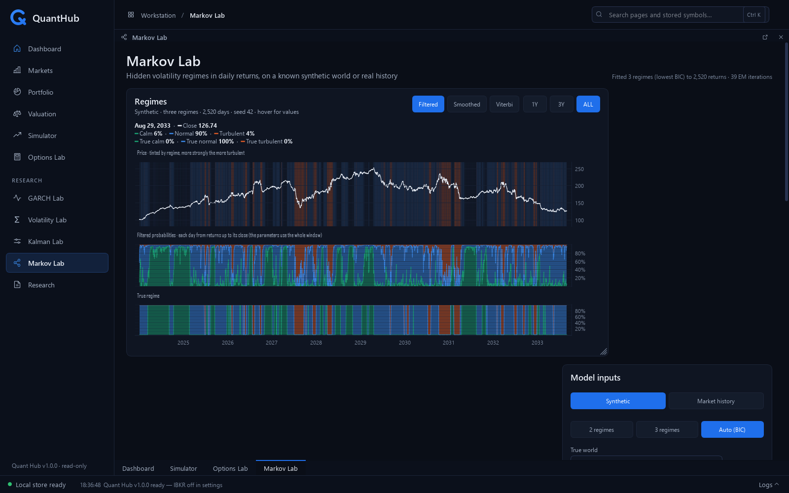
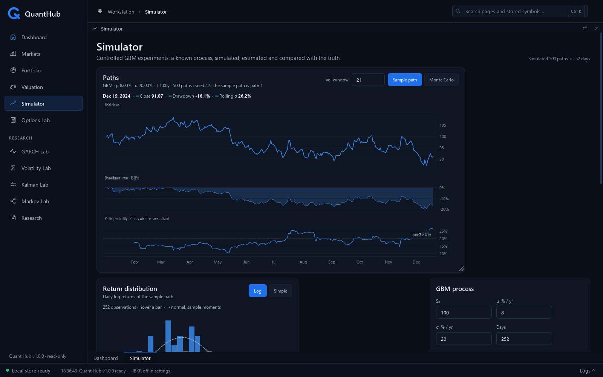
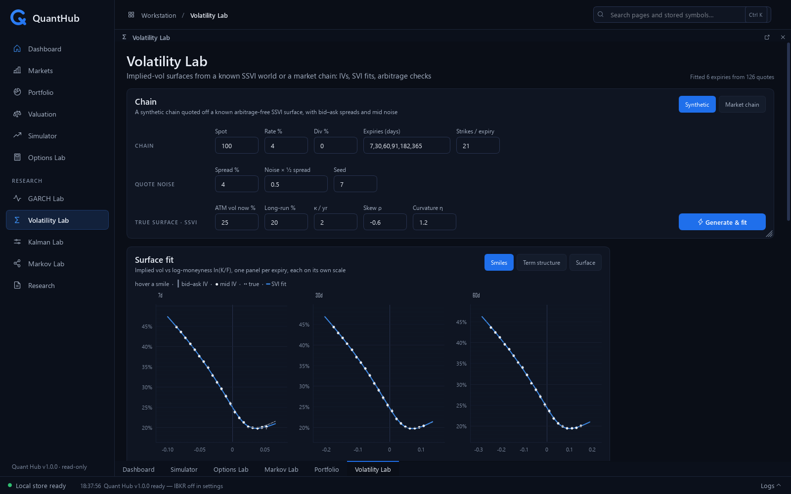
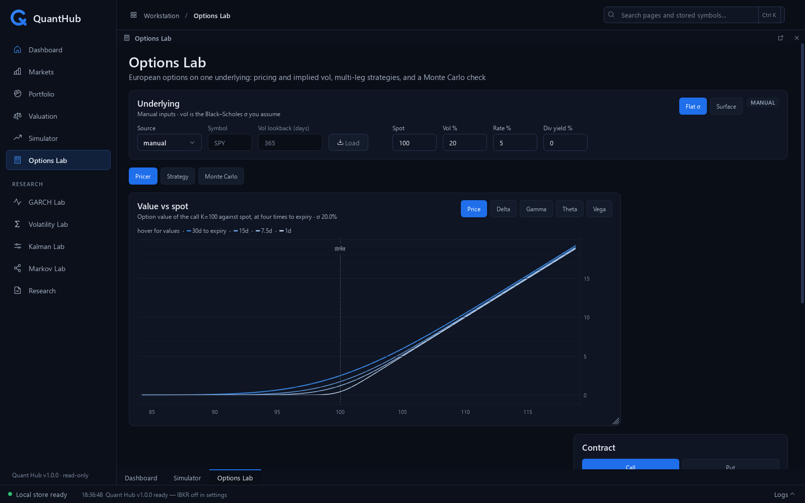

# Quant Hub

A quantitative research workstation for the desktop. It's a fast Qt
interface over a layered Python core, for pricing, volatility, regimes,
backtests and portfolio risk. Every model is derived in its docstring and
tested against the closed forms.



- **Research labs:**
  - **Simulator:** GBM and Monte Carlo against the closed forms.
  - **GARCH Lab:** conditional volatility, on synthetic or real history.
  - **Options Lab:** Black–Scholes–Merton, implied vol, multi-leg
    strategies and a Monte Carlo check.
  - **Volatility Lab:** SVI/SSVI implied-vol surfaces with arbitrage
    checks, as a heatmap or a rotatable 3D surface.
  - **Kalman Lab:** a hidden price level (and trend) filtered from noisy
    closes, with the smoother and maximum-likelihood fits.
  - **Markov Lab:** Gaussian regimes, filtered against hindsight states,
    with forecasts.
- **Research:**
  - six daily strategies with rolling training and refits
  - explicit costs and risk sizing, against matched benchmarks
  - sweeps with the deflated Sharpe ratio
  - exact saved inputs and decisions
  - a local paper library with PDFs, notes and links to experiments
- **Portfolio:** imported positions with option-aware risk:
  - historical and Gaussian VaR and expected shortfall
  - risk contributions and Kelly with its uncertainty
  - growth by sleeve, and α/β regressions
- **Valuation:** a discounted cash flow from a company's SEC filings.
- **Market data:** daily history is validated and kept in a local SQLite
  store through a coverage-aware cache. Data comes from CSV imports or,
  optionally, Interactive Brokers.

The synthetic labs know the true process, so they show the truth and the
estimate side by side. **Quant Hub never places orders.** Brokerage access
is read-only, and there is no order code.

| | |
|---|---|
|  |  |
|  |  |

## Getting started

On Windows, install Python 3.12, then run:

```bash
git clone https://github.com/aadabathon/quanthub.git
cd quanthub
py -3.12 -m pip install -e ".[dev]"
py -3.12 -m quant_hub          # or the quant-hub launcher (windowed)
py -3.12 -m pytest -q          # no display or network required
```

**No broker is needed.** The synthetic labs and Research work as soon as
the app opens:
- In Research, press **Run** for a random-walk control.
- Then choose **Planted trend** and a short momentum lookback, to test
  whether a rule can find a known mechanism.

These are simulated worlds, not forecasts. To use your own daily
histories, import them with Dashboard → Import CSV…, then select `file`
and its price basis in Research.

**Brokerage support is optional.** Install it with
`py -3.12 -m pip install -e ".[dev,ibkr]"` and follow the IBKR setup
below. The app never connects or reconnects on its own.

## Architecture

Imports point strictly downward; `tests/test_layering.py` enforces this.

```
gui/            PySide6 (Qt) presentation with pyqtgraph charts: renders
                state, forwards intent. No math, no broker calls.
services/       Application facade (MarketService), cache/sync layer,
                page-facing data assembly. Never the GUI toolkit or ibapi.
models/         Pure quantitative models (Black-Scholes, strategies, GARCH,
                SVI/vol surfaces, Monte Carlo, shared optimizer).
data/           Pure domain: PriceHistory/Quote/OptionChain types, GBM
                generator, simulation, return/risk analytics, validation.
                Usable from notebooks/scripts with zero GUI machinery.
broker/         Infrastructure. The ONLY package that imports ibapi.
                Read-only: there is no order code.
storage/        SQLite persistence (stdlib sqlite3) for acquired bars and
                per-page UI state; DB at ~/.quant_hub/market_data.db.
visualization/  Matplotlib figures for scripts and notebooks.
events.py       Thread-safe bus: background threads publish, GUI drains.
tasks.py        TaskRunner: one worker thread; results land on the GUI thread.
core.py, app.py Composition root: the one place everything is wired.
```

### Concurrency model

Two rules produce the whole design:

1. **Only the GUI thread touches widgets.** Background work re-enters the
   GUI through one 16 ms `QTimer` pump (`MainWindow._pump`) that drains the
   event bus and the task-result queue.
2. **ibapi's callback/threading model never leaves `broker/ibkr.py`.** The
   network thread's callbacks fill per-request buffers and set
   `threading.Event`s; callers see plain blocking methods with timeouts that
   raise `BrokerError`. The GUI invokes those via `tasks.py`
   (`submit(fn, on_done, on_error)` — callbacks run on the GUI thread).

### Data flow

```
page action ── TaskRunner (worker thread)
    ├─ synthetic experiment (GBM, GARCH, SSVI chain) ── true process known
    └─ MarketService ── named source (no global "active" source)
         ├─ SyntheticSource ── GBM generator ──► PriceHistory
         └─ CachedSource ── SQLite hit? ──────► PriceHistory
              └─ miss/partial: IBKRSource ── IBKRBroker ── TWS
                 └─ validate ── persist ── serve from store
    then pure models/analytics ──► one immutable result
    └─ queued ── pump ── every chart and stat on the page renders from it
```

Every consumer works from the same validated `PriceHistory`, so code is
source-agnostic.

[ARCHITECTURE.md](ARCHITECTURE.md) has the full module map, the page
responsibilities and the GUI conventions.

## Settings

The first run writes `~/.quant_hub/settings.toml`, a commented file of the
defaults. Edit it and restart. It sets:
- where the market-data store lives
- whether and how to reach Interactive Brokers
- your SEC identity, for Valuation

**Don't use IBKR?** Set `enabled = false` under `[ibkr]`, and its controls
and sources disappear. The app is complete on synthetic data without it.

**A mistake in the file never stops the app.** It's reported in the log,
and that setting keeps its default.
`QUANT_HUB_SETTINGS=path/to/other.toml` uses another file.

**The store is versioned.** Before an update changes its schema, the app
copies the whole database into `~/.quant_hub/backups/`. It never deletes
those copies itself.

## Importing data

The Dashboard's Market data card imports CSV files of daily bars (its menu:
Import CSV…). Imported bars are validated like any other provider's and
stored under the source `file`, which every page can then use. The generic
layout:

```text
date,open,high,low,close,volume,adj_close
2024-01-02,472.16,473.67,470.49,472.65,123623700,466.71
```

- **Columns:** any case and order, and other columns are ignored.
  - `close` is the price as traded; `adj_close`, adjusted for dividends
    too.
  - A file needs at least one of the two, and stores the bases it has.
  - `open`, `high`, `low` and `volume` are optional.
- **Dates** are YYYY-MM-DD.
- **Symbols:** a `symbol` column lets one file hold several. Without one,
  the file name is the symbol (`SPY.csv`), or the app asks.
- **Bad rows** fail validation and are dropped and reported.

Stooq downloads use this layout as they are. Nasdaq.com and Yahoo Finance
downloads are recognized by their headers.

## Portfolio

The Portfolio page imports a broker's positions CSV (Import positions…)
and shows its risk.

- **Headline:** volatility, one-day VaR and expected shortfall (historical
  and Gaussian), beta to a benchmark, and the worst drawdown today's mix
  would have had over the lookback.
- **Holdings table:** each holding's share of the value beside its share of
  the risk, sorted by risk.
- **Sizing:** Kelly leverage, shown with its standard error.
- **Growth:** today's mix's growth rate, CAGR and vol drag, from the
  replay with options repriced in full.
  - Each sleeve's contribution and verdict: adds, oversized, undersized
    or costs.
  - Its minimum-variance size (the hedge ratio, well estimated) and its
    growth-optimal size (shown with its much larger error).
  - A read-only what-if, and the options book's greeks and annual carry.
- **Regressions:**
  - each holding's and the portfolio's α and β on the benchmark, and on up
    to three extra factor ETFs
  - Newey–West errors, and optionally the Dimson sum β for stale prices
  - a rolling β for any row
  - the residual links between holdings, strongest first: are the streams
    orthogonal?

**Fidelity's downloads are read as they are:**
- the Portfolio Positions download, one account per row
- the Positions view's download, which has no account column, so all its
  rows count as the view's account (e.g. "All Accounts")

To keep accounts apart, export each account from the Positions view and
select all of the day's files in one import. They become one snapshot,
with the accounts in the account selector.

**Any other broker works through the generic layout:**

```text
symbol,quantity,price,cost_basis,account
AAPL,50,227.52,7500,Brokerage
-AAPL260116C250,-1,4.15,,Brokerage
CASH,1250,,,Brokerage
```

- Options are `ROOT YYMMDD C|P STRIKE`, contracts negative when short.
- Imports are kept as dated snapshots.
- Before any import, the page shows a $100,000 example portfolio.

## Valuation

A discounted cash flow from a company's SEC filings.

- **Company:** type a ticker or CIK. Its 10-K facts come from the SEC's free
  companyfacts API and are kept in the local store; Refresh refetches.
  Every gap in the filings is named with its reason, never filled in.
- **Assumptions:** seeded from the company's own trailing averages, and
  editable as one number for every year, or one per year
  (`12, 10, 8, 6, 5`).
  - The conventions are choices: the terminal cash flow (last-year or
    steady-state), value as of the year end or today, and netting
    marketable securities.
- **Result:** value per share, the EV bridge with the terminal value's share
  of it, the projection, a WACC × terminal-growth grid, and what the price
  implies: every growth rate and WACC that gives it, and whether there can
  be only one.
- **Price:** from a source (its quote, else its last close) or typed, for the
  margin of safety.
- **Screen:** your holdings or a list of tickers, each seeded from its own
  filings, ranked cheapest first, exported as CSV.
- **Saved valuations:** immutable records. Reopening one says whether the
  filings have changed since.

The SEC asks every program that downloads its filings to say who is asking,
so add your name and email to `settings.toml`:

```toml
[sec]
identity = "Your Name you@example.com"
```

**Limits:**
- Filings already in the store work without an identity.
- An unlevered DCF is the wrong model for banks, insurers and REITs.
- IFRS filers aren't mapped yet.

## Research workspace

**Experiments** has Data, Rule and Costs forms.
- **Windows:** training prices precede each test block, and reported
  returns exclude the warm-up.
- **Rules:** momentum, mean reversion, Kalman trend and level, GARCH
  volatility targeting, and Markov calm-regime.
  - They use equal asset budgets with a volatility target and a long/cash
    exposure cap.
  - Model rules refit on rolling training windows and use forward filters.
- **The benchmark** enters an equal-weight buy-and-hold basket on the same
  dates, with the same costs. Its exposure is 100%, whatever the risk
  target.

**What you can inspect:** equity, drawdown, rolling Sharpe, exposure,
trade notionals, fees and fit windows. Each rule's threshold is explained.

**Sweeps** vary the signal or risk window and the threshold. GARCH uses
individual experiments instead.
- All trials and the sweep manifest are saved.
- The deflated Sharpe ratio assumes IID returns and an effective
  independent-trial count that you choose.
- A selected test window is **not an untouched holdout**. Searches you ran
  outside the grid still count when you weigh the evidence.

**Saved runs** replay the exact captured prices and target weights. They
don't fetch newer bars or refit.
- Each run keeps its configuration, provenance, fitted parameters,
  software source fingerprint, statistics and an editable conclusion.
- Reopening one warns if the implementation has changed.
- The close-t execution convention is idealized. Impact, taxes, borrow
  costs and serial-dependence corrections are outside v1.

**Papers** keeps your reading next to your experiments.
- **What it holds:** PDF imports, source-only references, metadata,
  topics, reading status, searchable notes, and links to experiments.
- **Five foundational references** seed the catalog. Their PDFs aren't
  bundled: import your own files, or attach a PDF to an existing
  reference.
- **Where the files go:** imported copies live in `market_data.papers/`
  beside the SQLite store, named by content hash.
- **Back up both** the database and that folder: schema backups copy the
  database only.
- **Attach PDF…** can repair a missing file without replacing its notes.

The pure engine also runs from Python. Target weights use decision dates
and earn the following session's return. Costs include entry and
drift-driven rebalancing, paid from equity.

```python
import pandas as pd
from quant_hub.models.backtest import BacktestConfig, backtest
from quant_hub.models.backtest_stats import performance_summary

dates = pd.bdate_range("2025-01-02", periods=4)
prices = pd.DataFrame({"ASSET": [100, 110, 99, 105]}, index=dates)
targets = pd.DataFrame({"ASSET": [0.0, 1.0, 1.0]}, index=dates[:-1])
run = backtest(prices, targets, BacktestConfig(half_spread_bps=2, commission_bps=1))
report = performance_summary(run.net_returns, turnover=run.turnover)
# The first 10% jump was observed before entering: the strategy does not earn it.
print(run.equity)
```

- **`walk_forward_targets`** passes only training history to fitting, and
  history through the decision date to prediction.
- **Sharpe inference** assumes independent returns. The deflated Sharpe
  ratio also needs the recorded trial Sharpes and an explicit
  independent-trial count.
- **The derivations** for the accounting and the statistics are in the two
  modules' docstrings.

## Price bases

Every series is either **traded** (as it traded, split-adjusted) or
**adjusted** (for dividends too, so returns are total returns).
- The GARCH, Kalman and Markov Labs have a Prices choice, Adjusted by
  default. Price displays use traded prices.
- From IBKR, adjusted prices are refetched whole once a day, since every
  dividend rescales the past.
- A split after the cache stored a symbol is detected and repaired.

## Optional IBKR setup

Run TWS or IB Gateway with API access enabled (Configure → API → Settings →
"Enable ActiveX and Socket Clients").
- **Ports:** the default settings target live TWS on `127.0.0.1:7496`.
  Paper TWS is 7497, and IB Gateway is 4001 (live) or 4002 (paper): set
  `port` in settings.toml.
- **Enable TWS's Read-Only API.** The app contains no order code, so a
  read-only socket loses nothing.
- **TWS is optional.** The app works fully on synthetic data without it.

**Your accounts.** Portfolio's **From IBKR** button reads the login's
accounts, positions and balances. The read is read-only, and is kept as a
snapshot like a file import.
- Stocks, ETFs and US equity options are modelled. Each account's cash
  comes from its balances.
- Anything else, and anything not in USD, is left out and named.
- Positions are valued at the price source's last close.

**The `ibapi` version.** PyPI's `ibapi` is the old 9.81 build. Reading
accounts needs IBKR's current 10.x API, which isn't on PyPI.
1. Download the TWS API from IBKR's site (it asks you to accept its
   license).
2. Install its Python client:

       py -3.12 -m pip install "<the unpacked folder>/IBJts/source/pythonclient"

3. Check the version: `py -3.12 -m pip show ibapi`.

The broker code reads both versions. It checks the installed `error()`
signature, because 10.33 inserted a timestamp before the error code.

## Quantitative code conventions

`data/synthetic.py` (GBM) is the exemplar every model follows:
- the mathematical description and its discretization in the module
  docstring
- assumptions and units stated
- validated inputs
- tests that include statistical checks against closed-form moments

Models never import GUI or broker code. Each paper a model implements is
in the literature canon (`quant_hub/data/canon/`), with its DOI checked.

## Status

Version 1.0 runs on Windows with Python 3.12. The suite needs no display
and no network. Still to come:
- portfolio optimizers
- option strategy backtests
- more free data sources, kept locally

## License

MIT. See [LICENSE](LICENSE).
